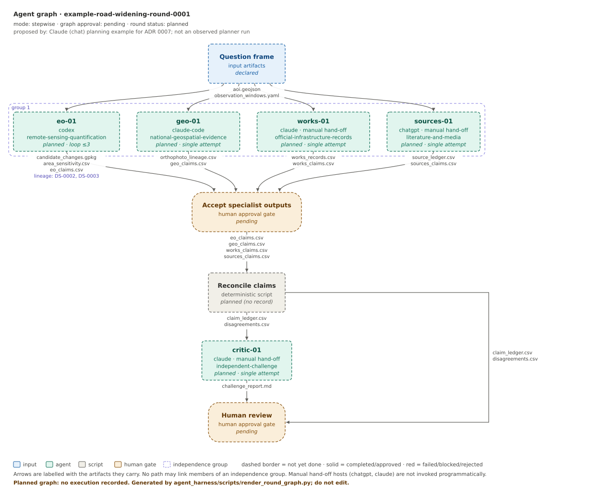

# Example: road-widening (planning only)

This example shows **selected, not used** subagents. Every `actual_executions` array is empty. No AOI, numeric result, report or execution is claimed. Supply actual coordinates/dated imagery/repository revisions and record execution only after observed work.

The manifest also carries a planned **agent graph** (ADR 0007): which agents exist, what each passes to the next, a human gate after the independent specialists, a deterministic reconciliation step, an independent challenge and a final human review. The graph and all gates are `pending`; artifact names are required outputs, not existing files.

`graph.svg` and `graph.mmd` are generated by `agent_harness/scripts/render_round_graph.py`; do not edit them by hand.

Copy the round files into the real inquiry location specified by `docs/agents.md`; store large data and measured output in the downstream review, not the Lab semantic corpus.
