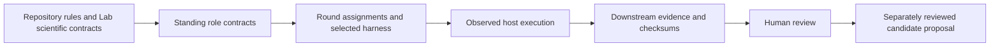

# Agentic research and execution architecture

**Status:** proposed standing policy for operator review (ADR 0006); intentionally independent of a particular research question, model or run.

## 1. Purpose and authority

Forest Cover Lab defines the scientific and governance rules used by human-operated general AI agents and task-specific specialist roles. Its purpose is to create **auditable hypotheses, measurements, evidence comparisons and explicit disagreements**, not to produce agent consensus.

- `AGENTS.md` carries mandatory repository-wide working rules. `CLAUDE.md` imports them for Claude Code.
- `docs/agents.md` (this file) defines the relatively stable agent system and accountability model.
- `agent_harness/roles/` defines reusable *logical subagent roles*, not vendor-specific agent processes.
- `agent_harness/templates/` and `agent_harness/schemas/` define the per-round record format.
- The *round* selects roles, provides task-bound instructions/configuration, identifies source and tool access, and freezes actual harness inputs used.
- Forest Cover Lab is semantic/scientific authority; `sentinel-monthly-forest-cover` is an executable downstream implementation. An operational investigation's data, rasters, calculations, and review stay downstream. The Lab may store research-round records or source references, never silently absorb a run's findings into canonical knowledge.

The graph/OKF-oriented corpus helps discover candidates and relationships, not execute a workflow or validate scientific claims. Agent outputs enter as `candidate` and remain subject to `governance/knowledge_promotion.md`.

## 2. General agents (hosts) versus specialist roles

| General agent / host | Role and access described by the operator | Repository-specific entry |
|---|---|---|
| ChatGPT | Research framing, critical analysis, synthesis and prompts; local project instructions available in its environment | Project instructions are external unless explicitly exported and hashed in a round |
| Claude | Research framing, critical analysis, synthesis and prompts; local project instructions and access to both GitHub repositories | External project instructions plus cited commit-pinned files |
| Claude Code | Code and research execution with access to both repositories | Reads `CLAUDE.md` -> `AGENTS.md`; can be handed round-specific role and assignment files |
| Codex | Code and research execution with access to both repositories | Reads `AGENTS.md`; can be handed round-specific role and assignment files |

Access here is an **operator-declared capability**, not an assertion that every service, MCP connector, browser, filesystem path or credential was available in every execution. Record actual tool use in the round. No model/version/tool permissions are globally pinned. A *subagent* is a bounded **responsibility**; it can run in a genuine delegated-agent facility or in an explicitly separate task/session of any general agent. Do not claim automatic orchestration or independent validation when neither occurred.

## 3. Subagent catalogue

| Role contract | Typical output |
|---|---|
| `agent_harness/roles/remote-sensing-quantification.md` | Georeferenced candidates, precise area calculations and sensitivity evidence |
| `agent_harness/roles/national-geospatial-evidence.md` | Dated national mapping/orthophoto data and source-lineage assessment |
| `agent_harness/roles/dataset-and-tool-discovery.md` | Dataset/tool search, FAIR-inspired evaluation, provider-link auditing and cited pipeline advice |
| `agent_harness/roles/official-infrastructure-records.md` | Authoritative construction/planning/road records and their temporal scope |
| `agent_harness/roles/literature-and-media.md` | Search-reproducible independent papers, journalism and alternative hypotheses |
| `agent_harness/roles/publication-method-reconstruction.md` | Reconstructed definitions, accounting objects and computable published methods |
| `agent_harness/roles/discrepancy-analysis.md` | Numerical discrepancy decomposition; residuals and competing interpretation ledger |
| `agent_harness/roles/independent-challenge.md` | Attempts to falsify conclusions, detect shared data lineage and enumerate unresolved tests |

The discovery role follows `research/data_sources/discovery_and_link_verification.md`. It can answer human or agent queries, assess new products/tools and verify scoped catalogue URLs. The external `eudr-dmi-gil` auto-catalogue is a read-only discovery seed until independently authorized. A role definition does not start a crawler, verify any link, execute an ingestion pipeline or promote evidence.

Roles are reusable defaults, **not** a requirement to invoke all roles. Tasks may generate additional role files in a round's local `assignments/`, with the instance explicitly declaring `role_scope: round_only`, or propose a broadly useful role for later review. Round-specific files may narrow or supplement a role contract but cannot override `AGENTS.md`, accepted ADRs, source/measurement semantics, the no-overclaim rules, or the human knowledge-promotion gate.

## 4. Round-specific harness and record

Each research round has one `round.yaml` conforming to `agent_harness/schemas/round.schema.json`. Its location is chosen by the project:

- Lab research question: `research/inquiries/<inquiry-id>/rounds/<round-id>/` (research process and evidence references only).
- Sentinel execution/investigation: `reviews/<investigation-id>/rounds/<round-id>/` in `sentinel-monthly-forest-cover` (execution and evidence; no upstream promotion).

Before starting, select roles and write an `assignments/<instance-id>.md` for each with a **question, inputs, bounds, permitted data sources/tools, acceptance checks, required outputs and failure conditions**. A round may also include optional `configs/`, `scripts/`, `source_scopes/`, `prompts/`, and `validators/`. Record **the exact files actually loaded** for each agent instance, including repository-wide rules, role contract, assignment, configs and tools. A role merely named in a manifest is not proof that its file was loaded.

Each agent instance distinguishes:

1. `selection_status`: `planned`, `started`, `completed`, `blocked` or `not_used`.
2. `actual_executions`: append-only execution attempts with host, timestamps, source revision, actual file fingerprints, prompt/session reference, observed tool availability, produced artifact references, checks, output SHA-256 values in `output_hashes`, and limits. Empty means **not run**.
3. `harness_sources`: candidate file references selected in planning; do not present them as observed loads.

Pin both repos by full commit SHA and the Lab graph revision (SHA-256) when a round is executed. For each loaded file record repository, commit/ref, path and SHA-256 (or a content-addressed captured copy); for external private project instructions record a stable identifier and digest **if permitted** or explicitly mark `not_captured`. Never copy secrets, personal documents or private prompts into a public repository. Changes to the pinned repository instructions require a new round. Append retries against the same baseline as new attempts; do not silently overwrite earlier evidence.

### Agent graph (optional, ADR 0007)

A round may add a `graph` block that makes the plan explicit before anything runs:
`input`, `agent` (one instance each, optional bounded `loop`), `script` and human `gate`
nodes; `edges` that name the artifacts they `carries`; `independence_groups` with no path
between members; `mode: stepwise` (each agent node needs an approved, hashed `step_plan`
before its first attempt) or `mode: auto` (only declared gates stop the chain); and a graph
`approval` whose `planning_record_id` a run manifest can cite. Every used instance must
appear in the graph, every sink must be a human gate and every recorded attempt must
follow the approvals it depends on. Draw and check with:

```sh
python agent_harness/scripts/render_round_graph.py <round.yaml>   # writes graph.svg + graph.mmd
python agent_harness/scripts/render_round_graph.py --root . --check
```

Images are records of the manifest, not evidence that a host followed it. Chat hosts
(`chatgpt`, `claude`) are marked as manual hand-off. No runner exists yet.

## 5. Workflow and independent checks

1. **Frame:** specify AOI, temporal window, forest definition/denominator, exact question, hypotheses and counter-hypotheses; choose which role outputs are required. A question about *road widening* is not synonymous with new-road construction; a forest-removal estimate is not necessarily forest-cover net change.
2. **Assemble:** general agent selects reusable roles, generates bounded assignments, configures access and a round manifest; record the operator-authorized scope and access; existing session authorization remains effective.
3. **Execute independently:** each role reports its own method, sources, observation/acquisition dates, output checksums, limitations and negative findings. Parallel role outputs may share a source and should be lineage-tagged, not counted as independent confirmations.
4. **Reconcile:** join by claim IDs, AOI and time frame; retain disagreements. Check methodology, footprint/CRS, thresholds, nodata, dates, classification, gross vs net, source edition and administrative denominators before attributing a discrepancy to any cause.
5. **Challenge:** an independent challenge role tests plausible alternative explanations and unexamined evidence. It must be able to return inconclusive or contradictory findings.
6. **Review and decide:** deterministic validation is distinct from scientific validity. Human review decides whether any candidate knowledge can enter the Lab's canonical corpus and whether a new method/ADR/role is justified.

Do not treat media publication as ground truth, a registry entry as proof of construction, a Sentinel anomaly as evidence of legal deforestation, or matching satellite layers as proof of independence or cause. Acquisition dates, publication dates, entry/registration dates and event dates are distinct fields.

## 6. Provenance, status and replay limits

Round record minimum: inquiry/round ID and status; question/claim IDs; AOI/time/measurement frame; upstream repo revisions and graph revision; selected role instances; harness sources; actual execution events and file hashes; sources with retrieval/acquisition times and independence groups; computation inputs/commands/versions; evidence IDs and checksums; conflicting and missing evidence; checks; human decision; explicit non-claims.

Git references or a deterministic script can enable calculation replay, but do not guarantee replay of a hosted model's reasoning or an external dynamic web search. For non-replayable sessions, retain prompt chain (subject to privacy), model/provider when known, timestamps, source snapshots and a human-review trail. Uncaptured project instructions are declared as a reproducibility limitation.

A new round can use previous results as *inputs* without inheriting their authority. A superseding round retains the prior record; it describes changed harness, evidence, method, calculations and conclusions. Do not overwrite prior rounds or mutate canonical Lab knowledge from an execution run.

## 7. Existing integration

The Sentinel repo already supplies four reusable Codex skills under `.codex/skills/`: `inspect-sentinel-change`, `research-sentinel-change`, `corroborate-sentinel-change`, `report-sentinel-change`. They are available tool-specific harness material, not evidence that all four were invoked in a future round. Link and hash those skills in a round when used. For Claude/ChatGPT/other runtimes, supply the relevant content explicitly rather than assuming a Codex skill auto-loads.

`tests/test_agent_registry.py` validates the stable registry. It should validate standing roles and schemas while a separate `tests/test_agent_harness.py` validates example and real round manifests and references, and `tests/test_agent_graph.py` validates agent-graph blocks and the freshness of their committed images. New round-scoped files **must not** require manual additions to this stable document. The round manifest is their inventory.

## 8. Governance of this policy

Change this file or the reusable role catalogue only when the agent architecture, canonical responsibility, or stable contract changes. Round-specific source choices, prompts, subagent composition and task parameters live in rounds, not in this file. Apply `governance/drift_checklist.md` and append to `governance/audit_log.md` after structural changes. No subagent may promote itself or its results to validated knowledge.

## Standing file index

The following are mandatory stable contracts (round-specific files are **not** added to this list):

- `AGENTS.md` — existing repository-wide instructions
- `CLAUDE.md` — existing Claude Code entry point
- `docs/agents.md` — this standing policy
- `agent_harness/README.md` — roles, selection and layout guide
- `research/data_sources/discovery_and_link_verification.md` — dataset/tool discovery, FAIR and link-health protocol
- `agent_harness/schemas/round.schema.json` — round data contract
- `agent_harness/templates/round.yaml` — new-round manifest seed
- `agent_harness/templates/assignment.md` — new-role assignment seed
- `agent_harness/scripts/validate_round.py` — cross-repository round validation CLI
- `agent_harness/scripts/round_graph.py` — agent-graph checks shared by validator and renderer (ADR 0007)
- `agent_harness/scripts/render_round_graph.py` — agent-graph SVG/Mermaid renderer (ADR 0007)

Any other stable, client-specific configuration that is subsequently added (such as
a `.claude/agents/` or `.codex/` skill) must be indexed here, while
`reviews/.../rounds/...` and `research/inquiries/.../rounds/...` are indexed
by their respective round manifests.

## Repository-wide rule dependencies

These contracts exist in the reconciled checkout and remain authoritative. The glossary,
governed overview generator and its tests were added upstream after the initial local
integration and are now preserved and indexed here.

- `CONTRIBUTING.md`
- `governance/principles.md`
- `docs/architecture.md`
- `docs/adr/`
- `docs/adr/0006-round-agent-harness.md`
- `docs/adr/0007-round-agent-graphs.md`
- `GLOSSARY.md`
- `docs/img/build_overview_diagram.py`
- `docs/img/problems-and-approaches.svg`
- `tests/test_overview_diagram.py`
- `configs/v1_defaults.yaml`
- `configs/downstream.sentinel-monthly.example.json`
- `validate/run_manifest.schema.json`
- `validate/semantic_provenance.md`
- `validate/validation_plan.md`
- `report/reporting_contract.md`
- `governance/knowledge_promotion.md`
- `research/methodology/search_scopes.csv`
- `governance/drift_checklist.md`
- `governance/audit_log.md`
- `docs/downstream_repos.md`
- `specs/`
- `knowledge/`
- `README.md`
- `graph/build.py`
- `graph/`
- `graph/generated/knowledge.json`
- `pyproject.toml`
- `tests/`
- `tests/test_agent_registry.py`
- `tests/test_agent_harness.py`
- `tests/test_agent_graph.py`
- `.github/workflows/ci.yml`
- `.pre-commit-config.yaml`
- `agent_harness/`

## Architecture at a glance



This is a documentation diagram, not an execution engine or a claim of completed review.
